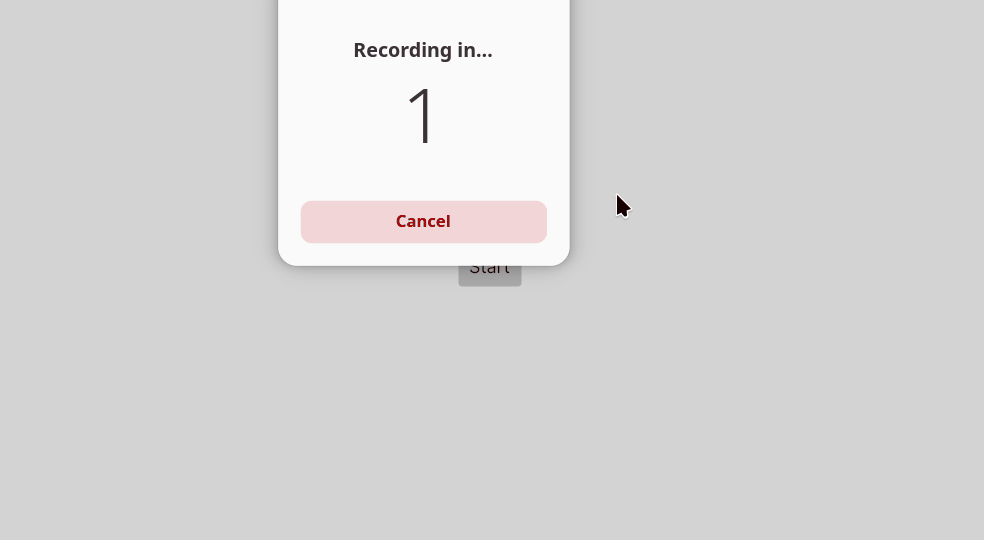

# Asteroid Shooter

A 2D asteroid shooter developed using C# and Avalonia UI as a practice project for a school assignment on Object-Oriented Programming.

## Demo




## Features

    Control the spaceship using the arrow keys.
    Shoot asteroids using the spacebar.
    Asteroids spawn and move in from all four sides of the screen.
    Earn points by hitting asteroids.
    Lose points when shooting.
    Game over when the spaceship collides with an asteroid.
    Automatic game over after 60 seconds.
    Restart the game using the Start button.

## Built With

    - C#
    - Avalonia UI

## Controls

**Arrow keys (up, down, left, right)**:	Move the spaceship

**Spacebar**:	Shoot

## Project Structure


## What I Learned

This project was developed to practise and apply fundamental OOP concepts.

    Classes: Creating and organising game objects using classes.
    Inheritance: Reusing and extending functionality through inheritance.
    Abstraction: Hiding implementation details and organising shared behaviour.
    Encapsulation: Structuring data and behaviour within objects.

    Working with keyboard input and game controls.
    Implementing collision detection.
    Managing game states, scoring and timers.

## Getting Started

#### Prerequisites
Make sure you have the following installed:

    .NET SDK (compatible with the project's target framework).
    An IDE such as Visual Studio, JetBrains Rider or Visual Studio Code.

#### Installation

1. Clone the repository:
   ```bash
   git clone https://github.com/Eline304/Asteroid-shooter.git
   ```
2. Navigate to the project directory:
   ```bash
   cd AsteroidDestroyer
   ```
3. Restore the NuGet packages:
   ```bash
   dotnet restore
   ```
4. Build the project:
   ```bash
   dotnet build
   ```
5. Run the application:
   ```bash
   dotnet run
   ```

   The game window should now open, and you can start playing!

## Development

Independently developed as a school assignment to practise Object-Oriented Programming and apply OOP.
